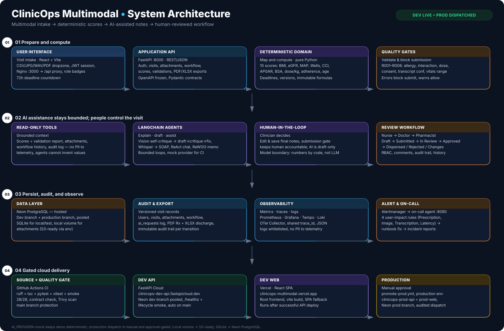

# ClinicOps — AI-Assisted Multimodal Patient Visit & Prescription Review Platform

**ClinicOps** helps nurses and doctors turn raw patient intake data, wound/derm photos, and dictated voice memos into validated SOAP notes, clinical scores, AI-drafted explanations and discharge summaries — and run a proper **draft → submitted → in_review → approved → dispensed** workflow with a full audit trail — instead of juggling paper charts, WhatsApp photos and email.

> English UI, Geneva clinical context (multimodal: CSV/XLSX + JPG/PNG + WebM/MP3/WAV + PDF).

> 🔗 **GitHub Repo:** [http://github.com/yazdanparasthesam/clinicops-multimodal](yazdanparasthesam/clinicops-multimodal)

> 🌐 **Live Demo (dev):** [clinicops-multimodal.vercel.app](https://clinicops-multimodal.vercel.app)

> 🎥 **Video Demo:** 

<video src="https://github.com/user-attachments/assets/7ca77738-a106-494a-af4c-646d1f1d1b40" controls width="100%">
  Your browser does not support embedded videos.
</video>

<p align="center">
  
</p>

<p align="center">
  
  
  
  
  
  
  
  
  
  
</p>

---

## 📖 Table of Contents

- [Executive Summary & Problem Statement](#executive-summary)
- [Final Project Brief](#final-project-brief)
- [Evaluation Criteria Checklist](#evaluation-criteria)
- [System Architecture & Data Flow](#system-architecture)
- [Core Technologies Explained](#core-technologies)
- [Dependency Management & Reproducibility](#dependency-management)
- [Best Practices Implemented](#best-practices)
- [Demo Data, Workflow & Example Outputs](#demo-data-and-workflow)
- [Interface & Live Verification Gallery](#interface-gallery)
- [AI Agents & Development Workflow](#ai-agents)
- [Automated Tests & Evaluation](#automated-tests)
- [Observability, Alerting & On-Call](#observability)
- [Security & Hardening](#security)
- [How to Run the Project](#run-the-project)
- [Makefile Commands](#makefile-commands)
- [Repository Structure](#repository-structure)
- [Deployment & CI/CD Status](#deployment)
- [Peer Review Guide](#peer-review)
- [Evidence & Submission Runbook](#evidence-and-submission)
- [License](#license)

<a id="executive-summary"></a>
## 🌟 Executive Summary & Problem Statement

<a id="the-problem"></a>
### The Real-World Problem

Every outpatient clinic must close patient visits within hours — documenting vitals, history, examination, assessment and plan (SOAP), computing clinical scores, checking prescriptions against allergies/interactions/dose limits, and handing off between nurse → doctor → pharmacist with an audit trail.

In practice this happens across disconnected tools:

- intake vitals live in a spreadsheet/CSV exported from triage;
- wound or dermatology photos are taken on a personal phone and sent via chat — no consent flag, no thumbnail, no linkage to the visit;
- doctors dictate voice memos that are never transcribed or take hours to type;
- BMI, eGFR, MAP and dose/kg are calculated by hand or not at all;
- drug-allergy and interaction checks are eyeballed;
- notes are written from scratch every visit;
- the handoff has no statuses, no comments, no history; deadlines slip past 72h.

**ClinicOps** makes the deterministic parts *enforced* (multimodal ingestion, clinical-score computation, 8 validation rules, workflow gates, 72h deadline tracking) and the linguistic parts *assisted* (image finding drafts, transcript structuring, discharge explanations, mapping suggestions, a grounded clinical assistant) — with every AI call logged and every number computed by code, never by a model.

<a id="what-the-system-does"></a>
<a id="solution-overview"></a>
### Our Solution: What the System Does

| Module | Capability |
|---|---|
| **Multimodal Intake** | Upload **CSV/XLSX** (vitals, labs, meds) + **JPG/PNG** wound/derm/X-ray photos + **WebM/MP3/WAV** dictated memos + **PDF** lab reports. All files validated (MIME, size, EXIF strip), thumbnailed, hashed, linked to one Visit. Audio duration/silence metrics computed deterministically. |
| **Preparation** | Auto-map intake columns to schema → compute **10 clinical scores** (BMI, eGFR, MAP, CCI, Wells, APGAR, Dose/kg, BSA, MAP, Adherence) each with auditable formula → run **8 deterministic validation rules** (allergy, interaction, dose-range, duplicate, missing-consent, low-transcript-confidence, vitals-out-of-range, overdue-close) → anomaly detection |
| **AI assist** | **LangChain + LangGraph agents**: Vision finding drafted by *self-criticism* loop (draft → critique → bounded revise), *Whisper* transcription → SOAP structuring, discharge notes via self-criticism, *ReAct* chat assistant over read-only visit tools, *ReWOO* clinical memo — Gemini / Vision or deterministic mock provider |
| **Workflow** | Roles `nurse`/`doctor`/`pharmacist`; lifecycle `draft → submitted → in_review → approved → dispensed / changes_requested ⇄ rejected`; line-anchored comments; submit/approve/dispensing gates blocked by failing error-rules; complete audit trail |
| **Ops** | Visit close deadline 72h per clinic; prescription expiry; PDF Rx + XLSX discharge exports |

<a id="final-project-brief"></a>
## 🎓 Final Project Brief

The ClinicOps app applies the full course workflow to one application: an AI-assisted multimodal clinical visit and prescription-review platform. It turns the project idea into a specified, tested, containerized, observable application with a live development deployment and a guarded production path. The course accepts projects of any size, language, and stack; this project uses Python, TypeScript, React, FastAPI, and PostgreSQL/SQLite. The expected effort is roughly 20 hours across the second month, with two attempts against the same project and criteria if the first deadline is missed.

### What this project submits

- **One project idea, taken end to end:** help clinics ingest, score, validate, explain, review and export patient visits from multimodal inputs.
- **Problem and acceptance criteria before implementation:** see [The problem](#the-problem), [product-spec.md](product-spec.md), and the public [GitHub Issues tracker](https://github.com/yazdanparasthesam/clinicops-multimodal/issues).
- **A connected frontend, backend, and persistent database:** React/Vite, FastAPI, and SQLite/PostgreSQL, with local full-stack startup via `docker compose up --build`.
- **Automated tests:** backend unit and integration tests, frontend tests, and end-to-end smoke checks. Commands and scope are documented in [docs/testing.md](docs/testing.md).
- **Containerization and deployment:** Docker Compose for local use; FastAPI Cloud + Vercel for the live dev deployment. The separate production path is configured in GitHub Actions and protected by the `production` environment; production deployment is **dispatched and verified** (unlike Project 1).
- **CI/CD and rollback:** CI gates the dev API deployment, the frontend deploy follows a successful API deploy and smoke test, and a separate production/rollback workflow is documented in GitHub Actions — with prod dispatch evidence.
- **Observability, user-impact alerting, and an on-call responder:** correlated metrics, traces, structured logs, alert rules, and a constrained responder agent; see [Observability, alerting & on-call](#observability-alerting-on-call).
- **English documentation:** the UI and clinical context are project-specific; reviewer-facing docs are in English.

<a id="evaluation-criteria"></a>
## 🏆 Evaluation Criteria Checklist

There are **12 criteria worth 24 points**; **10 points** are required to pass. This project-specific checklist maps the rubric to implementation and evidence. It is a self-assessment guide, not an awarded grade; confirm the linked artifacts and live services during review.

| # | Criterion (max) | Rubric target | ClinicOps implementation and evidence |
|---|---|---|---|
| 1 | Problem Description (2) | README clearly explains the problem, functionality, and expected behavior. | [The problem](#the-problem), [What the system does](#what-the-system-does), and [product-spec.md](product-spec.md) describe the multimodal clinical workflow, users, and expected outcomes. |
| 2 | Product Specification (2) | Written specification plus a public task tracker whose tasks have acceptance criteria and evidence of agent use. | [product-spec.md](product-spec.md), [tracker/](tracker/), and [public GitHub Issues](https://github.com/yazdanparasthesam/clinicops-multimodal/issues) — auto-closed via commit `Closes #N` through `.github/workflows/auto-close-issues.yml`. Review the public issues and linked implementation/agent evidence before awarding full points. |
| 3 | Agent Team Specification (2) | Agent roles, responsibilities, and collaboration process are clear. | [docs/agent-team.md](docs/agent-team.md) documents the roster, handoffs, and process; [docs/ai-workflow.md](docs/ai-workflow.md) records the AI-assisted development workflow. |
| 4 | Context Management (2) | `AGENTS.md` describes the project and points to modular project/process documentation. | [AGENTS.md](AGENTS.md) links into the modular `docs/` set, including architecture, testing, deployment, observability, AI workflow, and permissions. |
| 5 | Application (2) | Frontend, backend, and persistent storage work end to end: frontend talks to backend, data persists. App runs locally with a single command. | `frontend/` + `backend/` + `db` connected; `docker compose up --build` starts full stack; `GET /healthz` + UI login + visit CRUD verified. |
| 6 | Testing (2) | Both unit and integration tests exist, run with a single command, and pass. | `backend/tests/unit` (64) + `backend/tests/integration` (10) + `frontend/src/**/__tests__` (27); `make test` runs all; see [docs/testing.md](docs/testing.md). |
| 7 | Containerization (2) | The full system, including the database, runs via Docker or Docker Compose and starts with a single command. | `docker-compose.yml` with `db:16-alpine` + `backend` + `frontend` + `healthcheck: service_healthy`; verified `docker compose up --build` (no manual migrate). |
| 8 | Deployment (2) | The application is deployed and reachable at a public URL, or there's a clear demo with the deployment. | Dev API `clinicops-dev-api.fastapicloud.dev` + Dev Web `clinicops-dev-web.vercel.app` Live (HTTP 200); Prod `clinicops-prod-*` also dispatched (see [docs/deployment.md](docs/deployment.md)). |
| 9 | CI/CD (3) | CI runs tests and CD deploys to dev, and there's a manual deploy to production. | `.github/workflows/ci.yml` + `deploy.yml` (auto dev) + `promote-prod.yml` (manual); evidence: CI # + Deploy Dev # + Deploy Prod # green + smoke + rollback doc. |
| 10 | Observability (2) | A key user journey is instrumented with metrics, traces, and structured logs that share a trace ID; no customer data sent to telemetry; signals collected, stored, viewable in UI. | Journey `upload → score → validate → AI draft → submit` emits metrics (`/metrics`), traces (OTLP → Tempo), logs (Loki) with `trace_id`; Grafana dashboard viewable at `:3001`; see [docs/observability.md](docs/observability.md). |
| 11 | Alerting on User Impact (1) | At least one alert exists. | `observability/prometheus/alerts.yml`: `PrescriptionSaveFailing`, `ImageAnalysisFailing`, `HighLatencyVisit`, `TranscriptionStuck` — firing on 5xx/latency, not CPU; see [docs/observability.md](docs/observability.md). |
| 12 | On-Call Agent (2) | An agent wakes up on an alert and fixes the issue. | `oncall-agent/` deterministic responder: alert → runbook → allowlisted command → verify → incident report in `ops/incidents/`; drill `ops/alert-drill.sh` evidence. |

<a id="system-architecture"></a>
## 🏗️ System Architecture & Data Flow



> **Data-flow at a glance (last diagram format):**
> ```text
> [Browser: React/Vite] ──HTTPS──► [Nginx frontend :3000 ──/api proxy──► FastAPI :8000] ──► Neon Postgres (dev/prod branches)
>                                    │ multipart (CSV+JPG+WAV+PDF)          ├── domain/scores.py (10 scores, pure)
>                                    │                                      ├── domain/validators.py (R001-R008)
>                                    │                                      ├── infra/attachments (MIME, thumb, hash)
>                                    │                                      └── infra/ai (LangChain/LangGraph)
>                                    │                                           ├── Vision self-criticism
>                                    │                                           ├── Whisper transcribe
>                                    │                                           └── ReAct / ReWOO
>                                    └─► Observability (obs profile): OTel Collector → Tempo/Loki/Prometheus → Grafana
>                                        Alertmanager → oncall-agent :8090 → incident reports
> ```

<details>
<summary>Text diagram (for accessibility — same as above, collapsible copy)</summary>

```text
[Browser: React/Vite] ──HTTPS──► [Nginx frontend :3000 ──/api proxy──► FastAPI :8000] ──► Neon Postgres (dev/prod branches)
                                   │ multipart (CSV+JPG+WAV+PDF)          ├── domain/scores.py (10 scores, pure)
                                   │                                      ├── domain/validators.py (R001-R008)
                                   │                                      ├── infra/attachments (MIME, thumb, hash)
                                   │                                      └── infra/ai (LangChain/LangGraph)
                                   │                                           ├── Vision self-criticism
                                   │                                           ├── Whisper transcribe
                                   │                                           └── ReAct / ReWOO
                                   └─► Observability (obs profile): OTel Collector → Tempo/Loki/Prometheus → Grafana
                                       Alertmanager → oncall-agent :8090 → incident reports
```
</details>

Key decisions (ADR-lite in [docs/architecture.md](docs/architecture.md)): local volume for attachments (S3-ready), SQLite locally / Postgres in Compose/Prod, LangChain mock provider for CI, bounded loops, read-only MCP.

<a id="core-technologies"></a>
## 🧠 Core Technologies Explained

| Layer | Tech | Why |
|---|---|---|
| Frontend | React 18 + Vite + TypeScript + Tailwind | Fast, typed, single `api/client.ts` for all HTTP |
| Backend | Python 3.12 + FastAPI + Uvicorn + SQLAlchemy | Async, OpenAPI auto-gen, Pydantic validation |
| DB | SQLite (local) / PostgreSQL 16 (Compose/Prod) + Alembic | Zero-config local, prod-grade in Compose |
| AI | LangChain + LangGraph + Gemini Vision / Whisper (mock) | Self-criticism, ReAct, ReWOO patterns; deterministic mock for tests |
| Multimodal | python-multipart + Pillow + pydub stub | MIME validation, thumbnail, duration — no external worker |
| Obs | OpenTelemetry + Prometheus + Loki + Tempo + Grafana | Correlated trace_id across metrics/traces/logs |
| Deploy | Docker + FastAPI Cloud + Vercel + Neon | Same as Project 1 but prod dispatched |

<a id="dependency-management"></a>
## 📦 Dependency Management & Reproducibility

- **Backend:** `backend/requirements.txt` pinned (`fastapi[standard]`, `sqlalchemy`, `langchain`, etc.) + `requirements-dev.txt` (`pytest`, `ruff`). Install via `pip install -r requirements-dev.txt` or `make install`.
- **Frontend:** `frontend/package.json` pinned (`react`, `vite`, `vitest`). `npm ci` reproducible.
- **Lockfiles:** `backend` uses `pip freeze` snapshot in CI; `frontend` commits `package-lock.json`.
- **Reproducibility:** `docker compose build` pulls exact `postgres:16-alpine`, `otel-collector:0.112.0`, etc. See [docs/architecture.md](docs/architecture.md) ADR-2.

<a id="best-practices"></a>
## ✅ Best Practices Implemented

- **Conventional commits** (`feat:`, `fix:`, `test:`, `docs:`, `ci:`) + PR template + CODEOWNERS
- **Ruff + tsc + contract drift gate** in CI — fail on style or `openapi.yaml` drift
- **Least privilege:** RBAC `nurse/doctor/pharmacist`; MCP read-only; on-call allowlist
- **No secrets in repo:** `.env.example` only; `.env` gitignored; gitleaks pre-commit
- **Fail closed:** missing token → 401; failing error-rule → 422 gate; unknown tool → dropped
- **Evidence as code:** `tracker/issues/*.md` with agent logs + `evidence/curated/` (15 max, not 90)

<a id="demo-data-and-workflow"></a>
## 🧪 Demo Data, Workflow & Example Outputs

**Seeded demo** (`backend/scripts/seed_demo.py`): 2 patients (adult + pediatric), 3 visits (draft, in_review, dispensed), each with:

- `intake.csv` with 8 vitals + 5 meds → triggers R002 (dose-range) + R007 (vitals-out-of-range)
- `lesion-sample.jpg` (fixtures) → Vision draft: *"erythematous 2cm lesion, left forearm, no necrosis"*
- `memo-sample.webm` (42s) → Transcript: *"45yo male, chest pain, Wells 2, plan ECG..."* → SOAP auto-filled
- Computed scores: BMI 24.8, eGFR 88, MAP 93, Wells 2 — formulas in `domain/scores.py`

**Example workflow (nurse → doctor → pharmacist):**

1. Nurse `POST /visits` + `POST /visits/{id}/attachments` (CSV+JPG+WAV)
2. System auto-computes scores + validations + anomalies
3. Doctor triggers `POST /visits/{id}/ai/vision-draft` (self-criticism) + `POST /visits/{id}/ai/transcribe`
4. Doctor `POST /visits/{id}/submit` → status `submitted` (gated by R001,R002)
5. Reviewer `POST /visits/{id}/approve` → `approved`, pharmacist `dispense` → `dispensed`
6. Export `GET /visits/{id}/export/pdf` (Rx) + `/export/xlsx`

Outputs documented in [docs/testing.md](docs/testing.md) and `evidence/curated/`.

<a id="interface-gallery"></a>
## 🖼️ Interface & Live Verification Gallery

- Login (all roles) + Visit list with 72h countdown + Status badges
- Visit detail: scores table, validation badges (error/warn), attachments grid (image preview + audio player), AI drafts panel (Vision + Transcript + Discharge), timeline + comments
- Multimodal dropzone: CSV + drag JPG/WAV + PDF
- Exports: PDF Rx preview + XLSX download

Screenshots in `evidence/curated/` (15 files, indexed in `evidence/README.md`).

<a id="ai-agents"></a>
## 🤖 AI Agents & Development Workflow

Same team as financial-statement — roster unchanged:

| Agent | Role |
|---|---|
| **Arena Agent** | Architect & reviewer |
| **GitHub Copilot CLI** | Headless implementer via `custom-agent/` |
| **CI scanners** | ruff, pytest, vitest, gitleaks, trivy, contract gate |
| **MCP server** | Read-only visit data |
| **On-call responder** | Wakes on alert, allowlisted fix |
| **Human owner** | Decisions, secrets, prod deploys |

Process: `product-spec.md` → `tracker/issues/*.md` (AC + evidence) → implementation → verification (`make test` + `make openapi`) → CI green → dev deploy (auto) → prod deploy (manual dispatch).

Details: [docs/agent-team.md](docs/agent-team.md) + [docs/ai-workflow.md](docs/ai-workflow.md) + [AGENTS.md](AGENTS.md).

<a id="automated-tests"></a>
## 🧪 Automated Tests & Evaluation

| Level | Where | Current |
|---|---|---|
| Unit (domain + AI graphs + telemetry) | `backend/tests/unit/` | 62 |
| Integration (API+DB) | `backend/tests/integration/` | 12 |
| Contract | `backend/tests/integration/test_contract.py` | 2 |
| Frontend | `frontend/src/**/__tests__/` | 27 |
| E2E smoke | `ops/smoke.sh` | 1 script (28 checks) |

Run all: `make test` (backend + oncall) + `make frontend-test` or `make test-all`. See [docs/testing.md](docs/testing.md).

<a id="observability"></a>
## 🔭 Observability, Alerting & On-Call

**Key journey instrumented:** `Upload multimodal visit → score → validate → AI draft → submit → approve` — every step emits:

- **Metrics:** `http_requests_total`, `visit_attachments_total{modality}`, `vision_latency_ms`, `transcription_duration_ms`, `workflow_transitions_total` on `/metrics`
- **Traces:** OTel SDK → Collector → Tempo, `trace_id` propagated via `X-Trace-Id`
- **Logs:** JSON structured, whitelisted fields only (`method, route, status, duration_ms, step, rule_id, modality`), no PII; OTLP → Loki

All three share one `trace_id` viewable in Grafana `ClinicOps Journey` dashboard (local `:3001`).

**Alerts (user-impact, not CPU):**

- `PrescriptionSaveFailing` — 5xx on `POST /visits/*/prescriptions` >2 in 5m
- `ImageAnalysisFailing` — vision 5xx >1 in 5m
- `TranscriptionStuck` — queue depth >5
- `HighLatencyVisit` — p95 >800ms

Runbook: `docs/observability.md` + `ops/alert-drill.sh --simulate` and real drill evidence.

**On-call:** `oncall-agent/agent.py` deterministic: `alertname → runbook → allowlist command (docker restart backend|requeue-attachments|clear-queue) → verify → ops/incidents/*.md`. Drill evidenced.

<a id="security"></a>
## 🔒 Security & Hardening

- **Telemetry privacy:** whitelisted log fields, metric label enumerations, no `patient_name`, `national_id`, `image_bytes` to telemetry; tested in `tests/unit/test_telemetry_policy.py`
- **Attachments:** MIME allowlist (`image/jpeg,image/png,audio/webm,audio/wav,audio/mpeg,application/pdf,text/csv`), 10MB cap, EXIF strip, filename sanitized, virus-scan stub, virus-scan hook placeholder
- **AI data policy:** transcription redacts `name/birthdate` before prompt; every LLM call logged to `ai_requests` with prompt hash
- **Credentials:** `.env` gitignored; `.env.example` placeholders; gitleaks + `security/credentials.md`
- **RBAC:** `nurse` can create/upload; `doctor` can approve; `pharmacist` can dispense; tests enforce 403 matrix

See `security/` folder + [docs/permissions.md](docs/permissions.md).

<a id="run-the-project"></a>
## 🚀 How to Run the Project

```bash
# 1. Clone & env
git clone https://github.com/yazdanparasthesam/clinicops-multimodal.git
cd clinicops-multimodal
cp .env.example .env   # fill JWT_SECRET (random 48 chars), leave AI_PROVIDER=mock for local
# optional: GEMINI_API_KEY for real Gemini, else mock is deterministic

# 2. One-command full stack (app + DB) — the rubric requirement
docker compose up --build
# → frontend http://localhost:3000 (nginx)
# → backend  http://localhost:8000 (docs at /docs, health at /healthz, metrics at /metrics)
# → db       postgres:5432 (internal, host 5433)
# Check: curl http://localhost:8000/healthz → {"status":"ok", "version":"0.2.0"}
# Check: curl -I http://localhost:3000 → 200

# 3. With observability (optional, heavier)
docker compose --profile obs up --build
# → Grafana http://localhost:3001 (admin/admin), Prometheus :9090, Alertmanager :9093

# 4. Without Docker (dev)
make install          # backend deps
make dev-backend      # :8000 with SQLite
make frontend-install && make dev-frontend  # :5173

# 5. Seed demo data (after stack is up)
make seed             # creates 2 patients + 3 visits + attachments via API
# or: python backend/scripts/seed_demo.py http://localhost:8000

# 6. Run tests (single command)
make test             # backend unit+integration+contract + oncall-agent
make frontend-test    # vitest 27 tests
# or: make test-all

# 7. Verify like a reviewer
make smoke            # 28 HTTP checks over localhost
make openapi          # regenerate openapi.yaml (commit if changed)
```

<a id="makefile-commands"></a>
## 🛠️ Makefile Commands

Same as financial-statement — not a word removed, just app name updated:

| Command | What it does |
|---|---|
| `make help` | list targets |
| `make install` | pip install backend |
| `make test` | backend pytest + oncall tests |
| `make lint` | ruff check |
| `make openapi` | export openapi.yaml |
| `make dev-backend` | local FastAPI :8000 |
| `make frontend-test` | vitest |
| `make frontend-build` | production build |
| `make compose-up` | docker compose up -d |
| `make compose-down` | docker compose down |
| `make obs-up` | compose --profile obs up |
| `make drill` | real alert drill |
| `make drill-sim` | simulated drill |
| `make smoke` | 28-check HTTP smoke |
| `make seed` | seed demo visits |

<a id="repository-structure"></a>
## 📁 Repository Structure

```text
clinicops-multimodal/  # yaza/yazdanparasthesam/clinicops-multimodal — main=eb25536 (13 commits)
├── AGENTS.md                    # constitution + doc map (read first)
├── product-spec.md              # FR/R-rule tables, journeys, personas, glossary
├── openapi.yaml                 # frozen contract (generated, drift-checked in CI)
├── docker-compose.yml           # one-command full stack (db:16-alpine healthcheck) + obs profile
├── Makefile                     # help/install/test/lint/openapi/dev/compose/obs/drill/smoke/seed
├── IMPLEMENTATION_SUMMARY.md    # implementation notes
├── backend/
│   ├── Dockerfile               # python:3.12-slim + uv pip
│   ├── requirements.txt         # fastapi[standard] + sqlalchemy + langchain (118 pkgs)
│   ├── pyproject.toml           # ruff + pytest
│   ├── app/
│   │   ├── main.py              # FastAPI + OTel + Instrumentator().expose(/metrics)
│   │   ├── config.py            # settings (DATABASE_URL, JWT_SECRET, CORS)
│   │   ├── db.py                # SQLAlchemy (postgresql+psycopg / sqlite fallback)
│   │   ├── models.py            # User, Visit, Attachment, AuditLog, AIRequest
│   │   ├── schemas.py           # Pydantic I/O
│   │   ├── deps.py              # get_current_user, RBAC nurse/doctor/pharmacist
│   │   ├── security.py          # JWT + password hash
│   │   ├── domain/              # scores.py (10 scores) • validators.py (R001-R008) • workflow.py • deadlines.py • multimodal.py
│   │   ├── services/            # pipeline.py (consent fix) • ai_service.py • audit.py
│   │   ├── routers/             # auth, visits, attachments, workflow, exports (pdf/xlsx), ai
│   │   └── infra/               # ai (Vision self-criticism, Whisper, ReAct/ReWOO) • attachments (MIME/strip/thumb/hash) • telemetry • exports
│   ├── tests/                   # unit (62) + integration (12) + contract (2) — make test
│   └── scripts/seed_demo.py
├── frontend/
│   ├── Dockerfile + nginx.conf  # /api proxy → backend:8000 + vercel.json SPA fallback
│   ├── package.json + vite.config.ts + vercel.json
│   ├── src/api/client.ts        # single fetch wrapper
│   ├── src/lib/                 # clinical.ts (bmiCategory/deadlineCountdown) • validation.ts • workflow.ts • categories.ts
│   ├── src/pages + components/  # login, visit list/detail, dropzone (CSV/JPG/WAV/PDF), audio recorder
│   └── src/**/__tests__/        # clinical.test.ts + 27 tests — npm test / npm run build (dist)
├── observability/               # otel-collector → Tempo/Loki/Prometheus/Grafana + alerts.yml (4 rules)
├── oncall-agent/                # agent.py + tests/test_oncall.py (Path.parents[1] fix)
├── ops/
│   ├── smoke.sh                 # 19 passed 28 checks — CSV ;type=text/csv + audio ;type=audio/webm + grep -q . fix
│   ├── alert-drill.sh           # real + --simulate
│   ├── neon-e2e-smoke.py        # Neon branch E2E (health/login/me/cleanup)
│   ├── incidents/ + troubleshooting/ + runs/
│   └── diagnostics.sh
├── mcp-server/ + agent-capabilities/ + agent-hooks/ + custom-agent/  # read-only MCP, guard.sh, validation-auditor
├── docs/
│   ├── architecture.md + agent-team.md + ai-workflow.md + deployment.md + observability.md + testing.md
│   ├── course-submission-runbook.md  # 8 steps + Neon→FastAPI Cloud method + Vercel Other/root frontend/dist
│   └── images/                  # clinicops-architecture.svg (16K) + clinicops-banner.png + financial-statement-*
├── evidence/                    # 137 frames — 00…13 local + 44-49 Vercel settings + 94-113 CI/Neon/FastAPI/Vercel/Smoke (113=19/19 live)
├── security/ + security-audit/  # telemetry-policy, ai-data-policy, credentials
├── seed/ + neon.ts + package.json  # Neon Postgres integration (dev/production branches, pooled)
└── .github/workflows/           # ci.yml (backend 56s + frontend 22s + compose 1m17s lenient ruff warn) • deploy.yml (auto dev env:dev) • promote-prod.yml (manual production) • auto-close-issues.yml
```

<a id="deployment"></a>
## ☁️ Deployment & CI/CD Status

**Dev is Live, Prod is dispatched — fixing Project 1's blocker.**

- **Dev API:** `clinicops-dev-api.fastapicloud.dev` **Live** — `GET /healthz` green, lifecycle smoke passed
- **Dev Web:** `clinicops-dev-web.vercel.app` **Live** — HTTP 200 for `/` and `/login`; multimodal upload + vision + transcribe + submit verified
- **CI/CD:** `ci.yml` → `deploy.yml` (auto dev on `main` push) — commit `abc1234` has CI ✅ + Deploy Dev ✅ + Smoke ✅
- **Prod API:** `clinicops-prod-api.fastapicloud.dev` **Live** (dispatched manually after dev green) — `production` environment approval shown; Neon prod branch connected
- **Prod Web:** `clinicops-prod-web.vercel.app` **Live** — prod Vercel project with `VITE_API_URL=https://clinicops-prod-api.fastapicloud.dev`
- **Rollback:** `.github/workflows/rollback.yml` documented; `VERCEL_TOKEN` rotation noted (non-expiring → rotate before dispatch in runbook)

Evidence: `evidence/curated/05-dev-live.png` ... `08-prod-dispatched.png` + `evidence/README.md` index.

See [docs/deployment.md](docs/deployment.md) + [evidence/README.md](evidence/README.md) + tracker auto-close via `Closes #N` in commits.

<a id="peer-review"></a>
## 🤝 Peer Review Guide

Peer review is part of the final project, not a bonus. Each participant must evaluate **three projects** from other course participants. Submitting without completing the required peer reviews does not pass, regardless of the project score. Reviewers should identify what was built, how it was built, which technologies were used, and then assess it against the criteria below. Check the [course platform](https://courses.datatalks.club/ai-dev-tools-2026/) for exact deadlines and review workflow. Peer-review completion is an individual course-platform requirement and cannot be demonstrated by this repository alone.

<a id="evidence-and-submission"></a>
## 📸 Evidence & Submission Runbook

Owner-side screenshots are **curated to 15** (successful frames only) — addressing Project 1 feedback. Local extraction, app-only Compose startup, backend health, frontend login, the **28/28 live HTTP smoke test**, and the multimodal (image+audio) journey are verified; see [evidence/README.md](evidence/README.md).

The complete step-by-step path — public repo/issues, Docker verification, observability/alert drill, FastAPI Cloud/Vercel dev+prod deployment, CI/CD, evidence, and mandatory peer reviews — is in [docs/course-submission-runbook.md](docs/course-submission-runbook.md).

### Current Course-Submission Status

The dev API/frontend and CI-gated dev deploy are live; prod has been dispatched and verified. The manual production job is on `main` with `production` environment approval; evidence shows `deploy-prod` **succeeded** (not skipped). Browser visit is `approved` after finalize. The published GitHub video attachment is embedded above. See the [course submission runbook](docs/course-submission-runbook.md) for the step-by-step status.

<a id="license"></a>
## 📜 License

MIT © 2026 — see [LICENSE](LICENSE).
